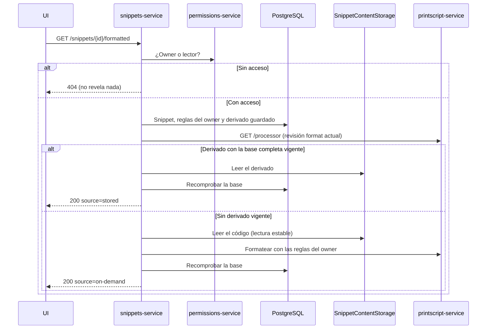

# SNI-66 — Descargar la variante formateada vigente (US13)

La descarga original ya existe: la UI arma el archivo con el `code` del detalle y
no cambia. Este ticket agrega la **descarga formateada**: el código guardado del
snippet, formateado con las reglas de su owner, solo si ese resultado es el vigente.

Estado: **implementado y verificado (03/11/2026).**

## API

| Ruta | Qué hace |
| --- | --- |
| `GET /snippets/{snippetId}/formatted` | Variante formateada vigente del snippet guardado, para el owner o un lector autorizado |

No recibe código ni reglas del navegador: siempre formatea lo guardado, con las
reglas que el owner tiene para el lenguaje y la versión del snippet. Un lector
obtiene el mismo resultado que el owner (D6 de [SNI-61](formatting-rules.md)).

Respuesta `200`:

```json
{
  "snippetId": "…",
  "name": "suma",
  "language": "printscript",
  "version": "1.1",
  "extension": "prs",
  "code": "let x:number = 1 + 2;\nprintln(x);",
  "source": "stored",
  "rulesRevision": "sha256-v1:…",
  "processorRevision": "sha256-v1:…"
}
```

| Campo | Qué es |
| --- | --- |
| `code` | Código formateado, UTF-8 tal cual lo devolvió el procesador |
| `name`, `extension` | Para que la UI nombre el archivo con la extensión real del lenguaje |
| `source` | `stored`: derivado publicado por el lote de [SNI-62](formatting-reprocessing.md). `on-demand`: formateado en este pedido |
| `rulesRevision`, `processorRevision` | La base con la que se produjo; sirven como evidencia (SNI-75) |

El original nunca se modifica y este `GET` no escribe nada: ni derivados, ni
trabajos, ni eventos.

## Recorrido



## Vigencia (V2)

Un derivado guardado se entrega solo si **toda** su base coincide con la actual,
con la misma regla `FormattingBasis.isCurrent` que usa SNI-62 al publicar:

| Parte de la base | De dónde sale la actual |
| --- | --- |
| Referencia del contenido, lenguaje y versión | El snippet confirmado ahora |
| Revisión de reglas | La configuración actual del owner para ese lenguaje y versión (vacía si no tiene) |
| Revisión `format` del procesador | `GET /processor` de printscript-service, `capabilities.format`, vía `Language.formatProcessor` |

Si falta el derivado o alguna parte no coincide, se formatea en el momento con
`FormatSavedSnippet` (SNI-61). Si la revisión del procesador no se puede verificar,
la respuesta es `502`: nunca se entrega un archivo guardado sin poder comprobar que
es el actual.

El resultado formateado en el momento **no se guarda** (V3). Por eso, un owner que
nunca cambió sus reglas no tiene derivado guardado y cada descarga formatea.

## Cambios concurrentes (V4)

| Situación | Resultado |
| --- | --- |
| El snippet o las reglas cambian mientras se lee el derivado guardado | Se recomprueba la base después de leer; si cambió, se formatea en el momento |
| El blob del derivado ya no está (lo descartó una publicación más nueva) | Se formatea en el momento |
| El snippet sigue cambiando al formatear en el momento | `FormatSavedSnippet` reintenta una vez; si vuelve a cambiar, `409 formatting-stale` |

En ningún caso se presenta como actual un resultado de una base vieja.

## Errores (V5)

El acceso funciona igual que `GET /snippets/{id}`: un tercero recibe `404`, sin
saber si el snippet existe.

| Status | Type | Cuándo |
| --- | --- | --- |
| `400` | `urn:snippets:problem:invalid-request` | El id no es un UUID (`field: snippetId`) |
| `401` | `urn:snippets:problem:identity-unavailable` | Identidad ausente o inválida |
| `404` | `urn:snippets:problem:snippet-not-found` | No existe, no está confirmado o el actor no tiene acceso |
| `409` | `urn:snippets:problem:formatting-stale` | El snippet cambió mientras se preparaba la variante. Repetir es seguro |
| `422` | `urn:snippets:problem:unformattable-code` | Un error léxico impide formatear. `diagnostics` trae `rule`, `message`, `line` y `column` |
| `422` | `urn:snippets:problem:invalid-formatting-rules` | Las reglas guardadas del owner ya no valen para el procesador actual. `violations` trae `rule` y `reason` |
| `422` | `urn:snippets:problem:unsupported-version` | La versión del snippet ya no tiene formatter |
| `422` | `urn:snippets:problem:formatting-limit-exceeded` | El código o el resultado superan el límite del procesador. `limit` es `code` u `output` |
| `502` | `urn:snippets:problem:dependency-failure` | Permissions o PrintScript no respondieron, o la revisión del procesador no se pudo verificar |
| `503` | `urn:snippets:problem:storage-unavailable` | No se pudo leer el código o el derivado |
| `503` | `urn:snippets:problem:metadata-unavailable` | PostgreSQL no está disponible |
| `500` | `urn:snippets:problem:technical-failure` | El contenido guardado está roto |

Ningún error modifica el original ni impide la descarga original.

## CORS (V8)

`/snippets/*/formatted` se registra con `GET`, con la misma política que el resto
(ver [CORS](cors.md)).

## Casos

| Caso | Resultado esperado |
| --- | --- |
| Owner con derivado vigente | `200 source=stored`, sin llamar al formateo |
| Owner sin derivado (nunca cambió reglas) | `200 source=on-demand` con las reglas vacías; nada se guarda |
| Lector autorizado | El mismo `code` que el owner, con las reglas del owner |
| Tercero sin acceso | `404`, sin contenido |
| Snippet editado después del lote | El derivado viejo no se entrega; `200 source=on-demand` con el código nuevo |
| Owner cambió las reglas y el lote no terminó | `200 source=on-demand` con las reglas nuevas |
| PrintScript actualizado a otra revisión | El derivado viejo no se entrega; se formatea con la revisión nueva |
| PrintScript caído | `502`; la descarga original sigue andando |
| Código con error léxico | `422 unformattable-code` con diagnósticos |
| Blob del derivado descartado | `200 source=on-demand` |
| Edición repetida durante el pedido | `409 formatting-stale` |
| Unicode y saltos de línea | Se conservan byte a byte en `code` |

## Decisiones

Aprobadas por Juan el 03/11/2026 («ok»).

| # | Decisión | Alternativa descartada | Costo aceptado |
| --- | --- | --- | --- |
| V1 | `GET /snippets/{id}/formatted` con JSON; la UI arma el archivo con un Blob, como la descarga original | Responder el archivo con `Content-Disposition` | El código viaja escapado en JSON; un link directo igual no sirve porque hace falta el header de identidad |
| V2 | Derivado guardado solo con la base completa vigente, incluida la revisión `format` actual; si no, formato en el momento | Confiar en el guardado sin consultar a PrintScript | Una llamada a `/processor` por descarga; sin PrintScript, `502` |
| V3 | El formato en el momento no se guarda | Guardarlo como derivado | Sin cambios de reglas no hay derivado y se formatea en cada descarga |
| V4 | Recomprobar la base después de leer; un reintento y después `409 formatting-stale` | Entregar lo leído sin recomprobar | Un reintento más en casos raros |
| V5 | Acceso como el detalle; tres tipos nuevos (`unformattable-code`, `formatting-limit-exceeded`, `formatting-stale`) | Un error genérico | Tres tipos más en `SnippetProblem` y en la UI |
| V6 | Botón "Descargar formateado" en la UI, pedido al tocarlo, separado del original y del borrador | Pedirlo al abrir el detalle | Un clic con espera |
| V7 | Owner y lector reciben lo mismo, con las reglas del owner | Reglas del lector | El lector no elige el formato |
| V8 | CORS de la ruta en el mismo PR, después del #65 | PR aparte | Orden de merge |

## Verificación

`./gradlew build` en verde (JDK 21 y Docker para Testcontainers): 616 tests, 18
salteados (los tests en vivo opcionales de siempre), ninguno fallido.

| Clase | Qué prueba |
| --- | --- |
| `DownloadFormattedSnippetTest` | Derivado vigente sin formatear; formato en el momento sin escribir; lector con las reglas del owner; derivado con otro código, reglas, procesador o versión nunca presentado como actual; procesador no verificable; edición durante la lectura del derivado; blob descartado; acceso rechazado sin tocar storage; errores tipados; metadatos caídos |
| `FormattedDownloadHttpTest` | Ruta real con PostgreSQL y Permissions y PrintScript simulados: nombre, extensión y Unicode exactos; lector con las reglas del owner y tercero con `404` sin contenido; `stored` contra `on-demand` por revisión del procesador; PrintScript caído con `502` mientras el original sigue; `422 unformattable-code` con diagnósticos y `422 formatting-limit-exceeded`; `400` y `401` |
| `PrintScriptFormatterTest`, `LanguageFormattingTest` | La revisión `format` sale de `GET /processor`; sin manifiesto válido o sin servicio, no es verificable |
| `CorsHttpTest` | `GET /snippets/*/formatted` permitido; otros métodos rechazados |
| `SnippetProblemTest` | La tabla de errores de este doc coincide con los problemas del servicio |
| `FormatSavedSnippetTest` | Sin cambios de comportamiento tras sumar la entrada con acceso ya comprobado |

### Evidencia en vivo — 03/11/2026

Stack aislado de Compose (proyecto propio, puertos 18080–18082) con esta rama de
snippets-service y `dev` de permissions-service, printscript-service e infra, con
Redis y el worker prendidos. Actores dev de SNI-75: owner `dev-thiago`, lectora
`dev-ana`, tercero `dev-bruno`.

| Comprobación | Resultado |
| --- | --- |
| Owner sin reglas guardadas | `200 source=on-demand`; Unicode (`¡Hola, señor! 🚀`) y saltos de línea intactos |
| Owner guarda `enforce-spacing-around-equals` y `enforce-spacing-after-colon-in-declaration` | El lote de SNI-62 llega a `COMPLETED` en unos 6 s |
| Owner después del lote | `200 source=stored`: `let saludo: string = "¡Hola, señor! 🚀";` |
| Lectora | El mismo código y `source=stored`, con las reglas del owner |
| Tercero | `404 snippet-not-found`, sin contenido |
| Original | `GET /snippets/{id}` devuelve el código sin formatear, sin cambios |
| Owner edita el snippet | `200 source=on-demand` con el código nuevo; el derivado viejo no se entrega |
| PrintScript detenido | Descarga formateada `502`; detalle y original `200` |
| PrintScript de nuevo arriba | `200` |

El stack se bajó y se borraron sus volúmenes e imágenes locales. El caso
`409 formatting-stale` y los errores de formato quedan cubiertos por los tests,
porque la creación ya rechaza código con errores léxicos.
