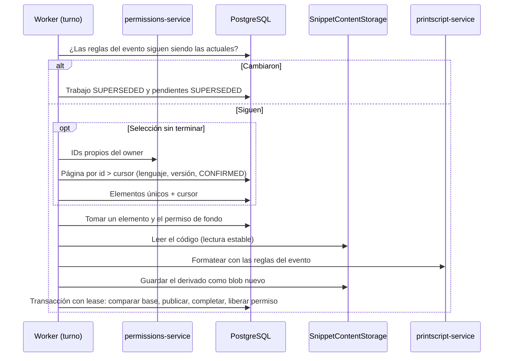

# SNI-62 — Reprocesar el formato cuando cambian las reglas (US12)

Cuando un owner confirma reglas de formato nuevas ([SNI-61](formatting-rules.md)),
el `PUT` responde al instante y deja el trabajo `format-owned-snippets` con el
evento `FormattingRulesChanged`. Este ticket agrega el handler que lo procesa en
segundo plano, sobre la base de [SNI-57](background-outbox.md) y
[SNI-58](background-consumer.md): recorre los snippets propios del owner para
ese lenguaje y esa versión, guarda un derivado formateado **separado del original**
y lo publica solo si sigue vigente.

Estado: **propuesto y aprobado; implementación en curso.**

## Recorrido de un lote

Cada turno del worker hace, como máximo, una página de selección y un snippet.
Después cede el turno, como pide la base común.

## Selección (E1)

| Regla | Detalle |
| --- | --- |
| Snippets propios | IDs `OWNED` del owner según Permissions, que es la autoridad del ownership |
| Filtro | En PostgreSQL: los de esos IDs con el lenguaje y la versión del evento, en estado `CONFIRMED` |
| Páginas estables | Orden por id y cursor `id > último`; tamaño `snippets.worker.item-batch-size` |
| Elementos | Uno por snippet y trabajo (`item_key` = id del snippet); repetir una página no duplica |
| Frontera | Cada elemento guarda la referencia del código que tenía al elegirlo. Si después se edita, se formatea el código actual y se publica solo si sigue vigente |
| Permissions caído | El turno se reintenta con espera creciente; el avance ya guardado no se pierde |

## Derivado y publicación (E2, E3)

El derivado se guarda como **blob nuevo** en `SnippetContentStorage`; el original
nunca se toca. La tabla `formatted_snippets` (migración V10) guarda un único
derivado vigente por snippet, con la base que lo produjo:

| Columna | Qué guarda |
| --- | --- |
| `snippet_id` | El snippet (clave primaria) |
| `source_reference`, `language`, `version` | Código, lenguaje y versión formateados |
| `rules_revision`, `processor_revision` | Revisión de reglas y revisión `format` verificada del procesador |
| `derived_reference` | Blob del código formateado |
| `job_id`, `published_at` | Trabajo que lo publicó y cuándo |

La publicación ocurre en la transacción protegida por el lease del trabajo
(`JobWork.persist`), sin HTTP ni storage adentro. Bloquea la fila del snippet,
compara la [base de formato](formatting-rules.md#vigencia-de-derivados) actual
con la usada y decide:

| Situación al publicar | Resultado |
| --- | --- |
| Código, lenguaje, versión y reglas iguales | Se publica: reemplaza el derivado anterior y el elemento queda `COMPLETED` |
| El código cambió mientras se formateaba | El elemento se reintenta y formatea el código nuevo |
| Las reglas del owner cambiaron | El elemento queda `SUPERSEDED`: el lote nuevo cubre la evaluación vigente |
| Cambió el lenguaje o la versión del snippet | El elemento queda `SUPERSEDED`: ya no pertenece a este lote |

Después del commit se descarta, con `ObsoleteContent.discard` de SNI-68, el blob
que quedó sin uso: el derivado anterior al publicar, o el nuevo si quedó superado.
Ante un commit incierto no se borra nada (puede quedar un blob huérfano), igual
que en SNI-57/68.

## Lote superado (E4)

Antes de cada turno el handler compara la revisión de reglas del evento con la
configuración actual del owner. Si cambió, el trabajo termina `SUPERSEDED` y sus
elementos pendientes también, en un solo paso. Para eso la base de SNI-58 suma
`JobStep.Superseded`. También suma el fallo de elemento con motivo, porque hoy
`completeItem(FAILED)` no guarda por qué falló.

## Capacidad (E5)

Cada llamada de formato reserva el permiso de fondo compartido con las
ejecuciones manuales: hay como máximo una operación pesada de fondo y se respeta
el cupo manual. Sin permiso disponible, el handler cede el turno sin llamar a
PrintScript.

Si el worker se cae durante la llamada, el permiso queda tomado. En el turno
siguiente, `reconcile` lo libera y reintenta el elemento. Es seguro porque
formatear es una función pura: repetirla no tiene efectos en PrintScript. Por
eso se usa `capacity.rejected`, aunque su nombre piensa en ejecuciones remotas.

## Fallos (E6)

| Tipo | Casos | Resultado |
| --- | --- | --- |
| Definitivo | Error léxico, reglas inválidas para el procesador actual, código o resultado demasiado grande, versión no soportada, contenido roto | Elemento `FAILED` con motivo; el lote sigue y termina `PARTIAL` |
| Transitorio | PrintScript caído o sin revisión verificable, storage caído, código editado durante el turno | Reintento del elemento con espera; tras agotar los intentos, `FAILED` |
| Del lote | Permissions caído al seleccionar | Reintento del turno; tras agotar los intentos, el trabajo queda `FAILED` |

Un snippet que falla nunca impide completar los demás.

## Núcleo compartido con SNI-61 (E7)

La lectura estable, la búsqueda de las reglas del owner, el formateo y la
verificación del procesador se extraen de `FormatSavedSnippet` a un componente
común. Lo usan el caso de uso individual (SNI-66) y este handler, sin duplicar
lógica. `FormatSavedSnippet` mantiene su comportamiento.

## Progreso

`GET /jobs/{jobId}` de SNI-58, sin cambios: el owner ve `status`, `processed`,
`failed`, `pending` y `selectionComplete`. Un lote con fallos individuales
termina `PARTIAL`; uno superado, `SUPERSEDED`.

## Ritmo (E8)

La base procesa un snippet por turno, y el turno siguiente llega cuando Redis
reclama la entrega pendiente (`snippets.worker.reclaim-idle`, 30 s por defecto).
Con 10 snippets, el lote tarda unos 5 minutos. Nadie espera ese tiempo: la
respuesta del `PUT` ya volvió. Ajustar ese valor en los ambientes es
configuración operativa (SNI-56); los tests usan un valor chico.

## Casos

| Caso | Resultado esperado |
| --- | --- |
| Reglas nuevas sobre varios snippets | Un derivado vigente por snippet; el original intacto; trabajo `COMPLETED` |
| Owner sin snippets en ese lenguaje y versión | Selección vacía; trabajo `COMPLETED` sin elementos |
| Snippets de otros owners o de otra versión | No se seleccionan |
| Caída con avance parcial | El turno siguiente retoma; los elementos completados no se repiten |
| Entrega duplicada del mismo evento | Mismo trabajo y mismos elementos; un solo derivado por snippet |
| Un snippet con error léxico | Ese elemento `FAILED` con motivo; el resto se publica; trabajo `PARTIAL` |
| Edición del snippet durante el turno | No se publica el formato viejo; se reintenta con el código nuevo |
| Reglas cambiadas otra vez | El lote viejo termina `SUPERSEDED`; publica solo el lote nuevo |
| PrintScript caído o sin revisión verificable | Reintento del elemento; nada se publica |
| Sin permiso de fondo disponible | Cede el turno sin llamar a PrintScript |
| Worker caído con el permiso tomado | `reconcile` libera el permiso y reintenta el elemento |

## Límites

No cambia la versión de lenguaje de ningún snippet, no reescribe el original, no
revalida con el parser y no emite eventos: producir un derivado no dispara US16.
La lectura del derivado guardado para descargarlo corresponde a SNI-66.

El Compose de infra todavía no tiene Redis (SNI-56). Las pruebas con PostgreSQL y
Redis reales usan Testcontainers dentro del build, y un test en vivo opcional
(`PRINTSCRIPT_SERVICE_URL`) usa el printscript-service real.

## Decisiones

Aprobadas por Juan el 02/11/2026 («dale, aprobadas las 8»).

| # | Decisión | Alternativa descartada | Costo aceptado |
| --- | --- | --- | --- |
| E1 | IDs propios desde Permissions + filtro y cursor en PostgreSQL | Usar `creation_actor_id` sin consultar Permissions | Una llamada a Permissions por página |
| E2 | Blob nuevo + tabla `formatted_snippets` con un derivado vigente por snippet | Guardar la referencia solo en el elemento del trabajo | Una tabla más |
| E3 | Publicar dentro de la transacción del lease comparando la base | Publicar y limpiar después | Un derivado viejo por edición queda guardado hasta el próximo cambio de reglas, sin presentarse como actual |
| E4 | `JobStep.Superseded` y fallo con motivo en la base de SNI-58 | Superar elemento por elemento | Se toca código compartido; se avisa a Juanfran |
| E5 | Permiso de fondo por cada formateo; `reconcile` libera y reintenta | No usar capacidad | Se usa `rejected` para algo que no es una ejecución remota |
| E6 | Fallos definitivos `FAILED` con motivo; transitorios con reintento | Reintentar todo | — |
| E7 | Núcleo de formato compartido con `FormatSavedSnippet` | Duplicar la lógica en el handler | Se toca código de SNI-61 sin cambiar su comportamiento |
| E8 | Mantener el ritmo de la base | Varios elementos por turno | Lotes grandes tardan minutos |

## Verificación

Pendiente: pruebas de aplicación, integración con PostgreSQL y Redis reales,
`./gradlew build`, test en vivo con printscript-service y regresión SNI-53.
